  

# 🚀 Awesome Collaborative API Development Workspaces 

> 🌐 A curated directory of premier SaaS platforms and open-source GitHub projects for collaborative API development, shared workspaces, real-time API design, team debugging, and cloud development environments.

  
  
  
  
  
  

This repository tracks notable **SaaS platforms** and **open-source repositories** empowering modern engineering teams to design, test, mock, document, and manage APIs together in shared workspaces. These solutions streamline developer workflows with real-time multiplayer co-authoring, Git-backed synchronization, role-based access control (RBAC), and reproducible cloud development environments—eliminating the risk, drift, and friction of passing static collection exports manually.

---

## 📑 Table of Contents

- [📊 Sector Overview & Market Dynamics](#-sector-overview--market-dynamics)
- [☁️ SaaS / Hosted Platforms](#️-saas--hosted-platforms)
- [💻 Open-Source GitHub Projects](#-open-source-github-projects)
- [🏗️ Architectural Recommendation: The Self-Hosted Collaborative Stack](#️-architectural-recommendation-the-self-hosted-collaborative-stack)
- [🤝 How to Contribute](#-how-to-contribute)
- [💖 Support](#-support)
- [📈 Star History](#-star-history)
- [⚠️ Disclaimer](#️-disclaimer)

---

## 📊 Sector Overview & Market Dynamics

The global API management and collaborative API development market is estimated at **$8.8B – $13.5B in 2026**, growing at a rapid CAGR of ~16.5%–28% propelled by microservices expansion, cloud-native deployments, and the surge in LLM/AI gateway integrations.

The sector is **moderately to highly fragmented** rather than a winner-take-all monopoly: while hyperscale cloud ecosystems (Microsoft, AWS, Google) and category incumbents (Postman, Kong) anchor enterprise software estates, agile developer-first and open-source/offline-first platforms (such as Bruno, Hoppscotch, and Yaak) continue capturing major market share due to surging demand for data privacy, predictable infrastructure costs, and avoidance of per-seat SaaS lock-in.

---

## ☁️ SaaS / Hosted Platforms

*Below is a curated comparison of hosted collaborative API development and cloud workspace platforms, sorted in descending order by company scale (valuation or market cap).*

| 🏷️ Product | 🏢 Company Scale (Valuation / Revenue) | 📝 Description | 💳 Pricing (Starting Paid Tier) | 🎁 Free Tier / Trial Limits |
|:---|:---|:---|:---|:---|
| **[GitHub Codespaces](https://github.com/features/codespaces)** | **~$3.87T Market Cap** (Parent: Microsoft; FY2026 Revenue: ~$331.8B) | Cloud development environments with shared port forwarding, reproducible devcontainers (`devcontainer.json`), and browser/desktop VS Code integration for collaborative API testing. | Compute starts at **$0.18/core-hour** (2-core: $0.36/hr active); storage billed at **$0.07/GB/month** beyond included allowances. | **Free plan (personal)**: 120 core-hours/month compute (~60 hrs on 2-core) + 15 GB/month storage; 30-min idle timeout. (Organization accounts require pay-as-you-go). |
| **[Replit Teams](https://replit.com/pricing)** | **$9.0B Valuation** (Annualized Revenue: ~$150M+) | Collaborative browser-based IDE and cloud development platform offering multi-user multiplayer editing, integrated hosting, and AI agent automation for full-stack API workflows. | **Core**: **$20/month** (or $204/year billed annually at $17/mo); **Pro**: $100/month for advanced multi-builder capacity. | **Starter (Free forever)**: Basic AI agent access with daily rate allowance, limited monthly cloud credits, and 1 published application. No time-limited trial on paid tiers. |
| **[Postman Workspaces](https://www.postman.com/pricing/)** | **$5.6B Valuation** (ARR: ~$270M–$313M) | Industry-standard API lifecycle workspace platform supporting shared collections, automated mock servers, monitor scheduling, and role-based access control (RBAC). | **Solo**: **$9/month** (single user); **Team**: **$19/user/month** (billed annually) or $29/user/month (billed monthly). | **Free plan (single user only)**: Unlimited collection runs and mock servers, 1,000 monitor requests/month, 50 AI credits/month. *Team workspaces require a paid tier.* |
| **[Insomnia Collaboration](https://insomnia.rest/pricing)** | **$2.0B Valuation** (Parent: Kong Inc.; ARR: $100M+) | Lightweight REST/GraphQL/gRPC API client by Kong with built-in end-to-end encryption (E2EE) and native cloud/Git workspace synchronization. | **Pro**: **$12/user/month** (annual) or $15/month; **Enterprise**: $45/user/month. | **Essentials (Free forever)**: Unlimited users on shared Cloud/Local projects, unlimited collection runs, E2EE sync, 1,000 mock requests/month; Git sync included for up to 3 users. |
| **[SwaggerHub Organizations](https://swagger.io/tools/swaggerhub/)** | **~$1.8B Valuation** (Parent: SmartBear Software; Revenue: ~$150M–$200M) | Enterprise API design and documentation governance platform built around the OpenAPI and AsyncAPI specifications with team style guides and access management. | **Individual**: starts at **$22.80/user/month** (annual); **Team**: starts at **$50.00/user/month** (billed annually). | **14-day free trial** of Team/Enterprise features (unlimited API definitions, team style checkers, mocks, and sync); ongoing free access restricted to open-source tools (Swagger Editor/UI). |
| **[Stoplight Workspaces](https://stoplight.io/pricing)** | **~$1.8B Valuation** (Acquired by SmartBear; raised $26M prior) | Design-first API development workspace featuring visual OpenAPI editing, mock services, multi-branch Git synchronization, and team style guide validation. | **Startup**: starts at **$113/month** (covers up to 8 users with multi-branch Git); **Pro Team**: $362/month (up to 15 users). | **14-day free trial** with full team workspace features, visual designer, and multi-branch Git sync. No permanent free team tier (Basic tier is single-user individual only). |
| **[Gitpod Teams](https://www.gitpod.io/pricing)** | **~$60M Valuation** (Ona / Gitpod; ARR: ~$7M–$8M) | Automated, ephemeral cloud development environments tailored for engineering teams to provision preconfigured API dev and testing sandboxes via code. | **Standard / Core**: starts at **$9.00/month** (includes base credit bundle); scalable via credit-based pay-as-you-go consumption. | **Free tier**: 50 hours/month (or ~500 usage credits/month) of ephemeral cloud workspace instances with standard compute. |
| **[Hoppscotch Workspaces](https://hoppscotch.com/)** | **~$30M Valuation** (OSS Capital Seed-backed; ARR: ~$2M) | Fast, cloud-hosted API ecosystem offering real-time team workspaces, unlimited shared collections, environment variables, and role administration. | **Enterprise Cloud**: starts at **$11/user/month** (billed annually) or $14/user/month (billed monthly). | **Community / Cloud Free**: Free forever for individuals and small teams with core request execution, real-time collaboration, and collection sharing. |
| **[Apidog Workspaces](https://apidog.com/pricing/)** | **Privately Held / Bootstrapped** (Est. ARR: ~$5M–$10M) | Integrated API lifecycle platform consolidating API design, automated test sequences, dynamic mock servers, and interactive documentation into shared workspaces. | **Basic**: starts at **$9/user/month** (billed annually) or $12/user/month (billed monthly); **Professional**: $18/user/month. | **Free tier (Free forever)**: Up to 4 team members with complete feature set, 5 active projects, unlimited collection runs, dynamic mocks, and community support. |

---

## 💻 Open-Source GitHub Projects

*Open-source API development clients, self-hosted workspace platforms, and API developer portals for privacy, data sovereignty, and Git-native collaboration. Sorted in descending order by GitHub stargazer count.*

| 📦 Repository | ⭐ Stars | 📝 Description |
|:---|:---|:---|
| **[Hoppscotch](https://github.com/hoppscotch/hoppscotch)** |  | Modern, lightweight, open-source API development ecosystem and web client. Provides real-time team collaboration, environments, and REST/GraphQL/WebSocket testing. |
| **[Bruno](https://github.com/usebruno/bruno)** |  | Offline-first, fast, and Git-friendly API client. Stores API collections directly as plain text files (`.bru`) inside your codebase for seamless Git version control without cloud lock-in. |
| **[Insomnia](https://github.com/Kong/insomnia)** |  | Open-source desktop API client for REST, GraphQL, gRPC, and WebSockets. Features Git synchronization, environment variable encryption, and collaborative debugging. |
| **[Backstage](https://github.com/backstage/backstage)** |  | CNCF-incubated developer portal platform created by Spotify. Centralizes software catalogs, API specifications, TechDocs ("docs like code"), and team developer workspaces. |
| **[Swagger UI](https://github.com/swagger-api/swagger-ui)** |  | Universal collection of HTML, JavaScript, and CSS assets that dynamically generate interactive documentation from OpenAPI-compliant APIs for developer consumption. |
| **[Yaak](https://github.com/mountain-loop/yaak)** |  | Fast, local-first, privacy-focused desktop API client for REST, GraphQL, gRPC, and WebSockets built with Rust and Tauri. Keeps API request collections stored locally in Git-friendly formats. |
| **[Coder](https://github.com/coder/coder)** |  | Open-source enterprise developer workspace platform. Provisions self-hosted remote development environments on Kubernetes, Docker, and multi-cloud VMs via Terraform templates. |
| **[Scalar](https://github.com/scalar/scalar)** |  | Modern, interactive API documentation and testing platform for OpenAPI/Swagger specs with built-in API client, real-time testing, and offline-first team collaboration. |
| **[DevPod](https://github.com/loft-sh/devpod)** |  | Client-only, open-source alternative to GitHub Codespaces. Spins up reproducible devcontainer workspaces on any infrastructure (Kubernetes, AWS, GCP, Azure, or local Docker). |
| **[Gitpod](https://github.com/gitpod-io/gitpod)** |  | Open-source platform for automated developer workspaces. Configures prebuilt dev environments from repository branches with native VS Code and JetBrains IDE support. |
| **[Swagger Editor](https://github.com/swagger-api/swagger-editor)** |  | Browser-based editor for designing, describing, and documenting APIs with the OpenAPI (formerly Swagger) specification, complete with real-time syntax validation. |
| **[WireMock](https://github.com/wiremock/wiremock)** |  | Popular open-source tool for API mocking and service virtualization. Enables teams to simulate complex API dependencies, fault injections, and edge cases collaboratively. |
| **[Eclipse Che](https://github.com/eclipse-che/che)** |  | Kubernetes-native cloud development workspace server. Provides secure, in-browser developer IDEs with isolated container runtimes for enterprise engineering teams. |
| **[Prism](https://github.com/stoplightio/prism)** |  | Open-source HTTP mock server and contract linter powered by OpenAPI v2/v3 documents. Generates realistic dynamic mock responses for team development before backend APIs are implemented. |
| **[Spectral](https://github.com/stoplightio/spectral)** |  | Flexible JSON/YAML linter with built-in rulesets for OpenAPI and AsyncAPI. Enables teams to standardize API design conventions and style guides across repositories. |
| **[Firecamp](https://github.com/firecamp-dev/firecamp)** |  | Open-source API development client designed for multi-protocol collaboration across REST, GraphQL, WebSocket, and Socket.io with modular workspace management. |

---

## 🏗️ Architectural Recommendation: The Self-Hosted Collaborative Stack

For engineering teams seeking data sovereignty, enterprise zero-trust security, and zero per-seat SaaS costs:

1. 🧪 **API Testing & Execution**: [Bruno](https://github.com/usebruno/bruno) or [Hoppscotch](https://github.com/hoppscotch/hoppscotch) for Git-native and web-based collection collaboration.
2. 📐 **Design & Contract Linting**: [Swagger Editor](https://github.com/swagger-api/swagger-editor) combined with [Spectral](https://github.com/stoplightio/spectral) for OpenAPI enforcement in CI/CD.
3. 🎭 **Dynamic Mocking**: [Prism](https://github.com/stoplightio/prism) or [WireMock](https://github.com/wiremock/wiremock) for decoupling frontend and consumer teams from unfinished backends.
4. 📖 **Developer Portal & API Catalog**: [Backstage](https://github.com/backstage/backstage) or [Scalar](https://github.com/scalar/scalar) for interactive API documentation and discovery.
5. ☁️ **Reproducible Cloud Workspaces**: [DevPod](https://github.com/loft-sh/devpod) or [Coder](https://github.com/coder/coder) to eliminate environment drift across local and remote developer machines.

---

## 🤝 How to Contribute

Contributions are warmly welcomed! To suggest a new tool or update existing details:

1. 🍴 Fork this repository.
2. 🌿 Create a new branch: `git checkout -b feature/add-new-workspace`.
3. ✍️ Add the project to the relevant section (maintain table sorting and column requirements).
4. 💾 Commit your changes: `git commit -m "Add <tool-name> to collaborative workspaces"`.
5. 🚀 Push to your branch and open a Pull Request.

---

## 💖 Support

Thank you so much for exploring and using this repository! If this curated list helps you or your team streamline collaborative API workflows, please consider:

- ⭐ **Starring** the repository on GitHub to help others discover it.
- 🍴 **Forking** and contributing new tools, fixes, or updates.
- 📢 **Sharing** with your fellow developers, platform engineers, and team leads.
- ☕ **Buying a coffee** to fuel ongoing curation and maintenance via the [GitHub Sponsors Dashboard](https://github.com/sponsors/ishandutta2007).

Your support is deeply appreciated and keeps open-source knowledge thriving! 🙌

---

## 📈 Star History

---

## ⚠️ Disclaimer

- 📌 This is a community-maintained list provided for informational purposes only.
- 🔄 Pricing, quotas, and feature tiers change frequently; always check vendor websites directly for the latest updates.
- 🔐 When evaluating collaborative API workspaces, audit data governance models (such as secret masking, end-to-end encryption, and role-based access control) to protect sensitive API keys and production credentials.

---

**Maintained by [Ishan Dutta](https://github.com/ishandutta2007) and the open-source developer community.**
